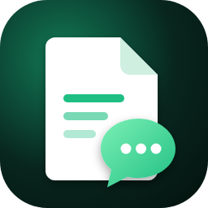
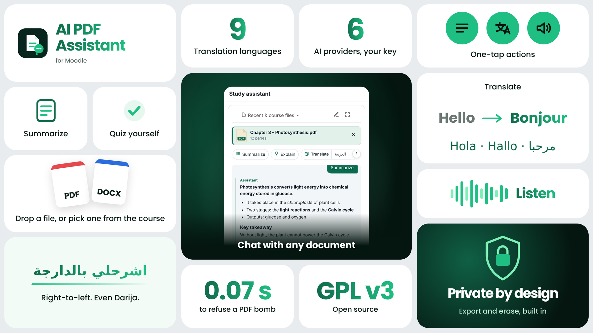
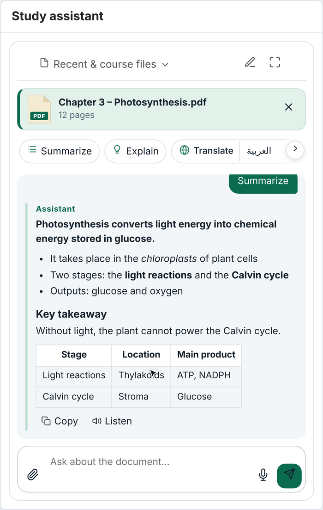
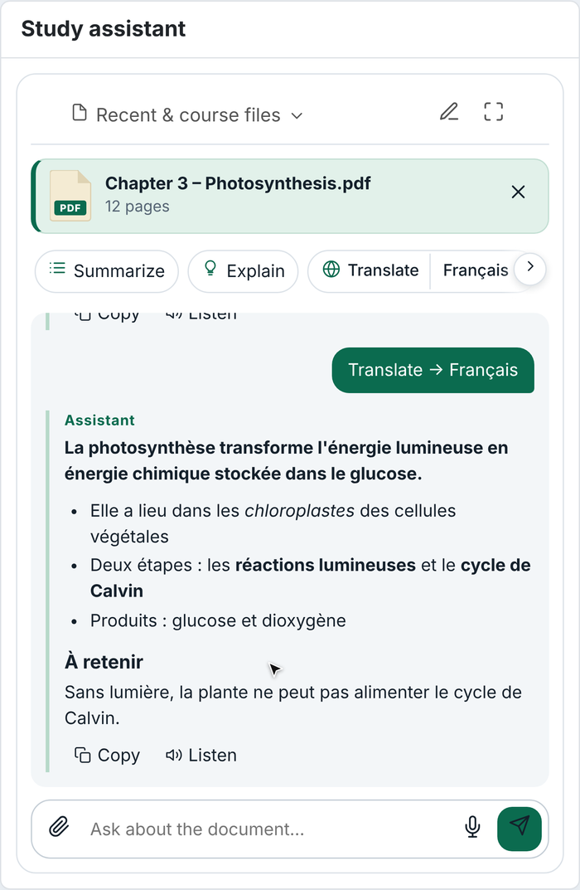
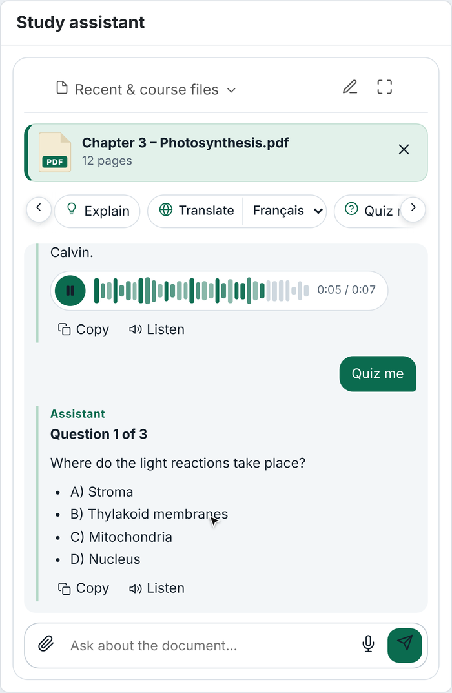
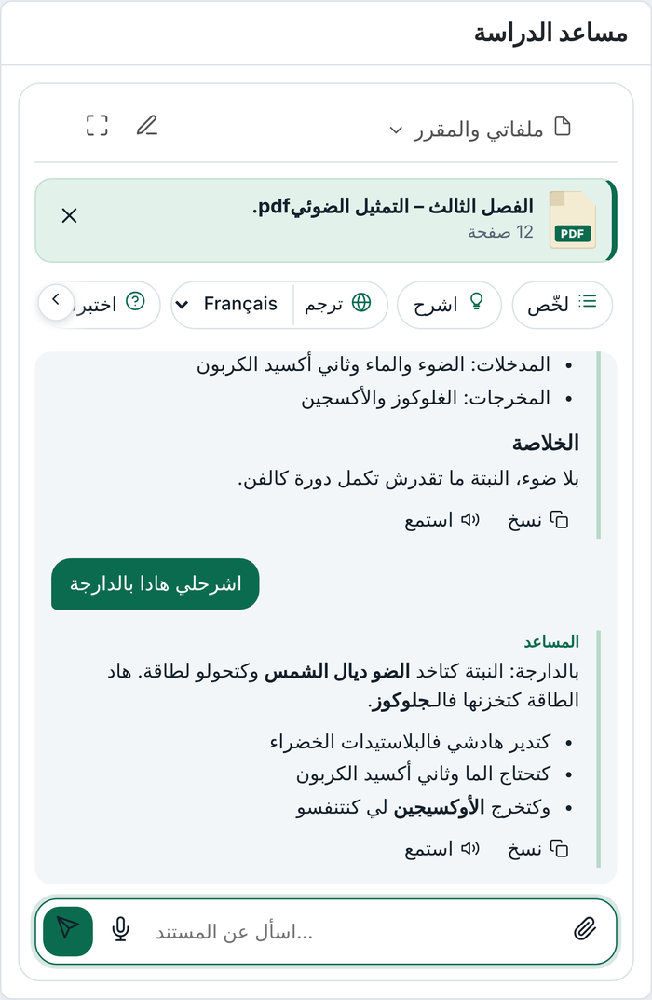

# AI PDF Assistant (block_aipdfassistant)

**Install it from the [Moodle marketplace](https://marketplace.moodle.com/plugins/block_aipdfassistant)** or download the zip from [Releases](https://github.com/hamzakhalem/moodle-block_aipdfassistant/releases/latest).

> ⭐ If this plugin saves you or your students time, a star on GitHub helps other Moodle admins find it.

A Moodle **block** where students and teachers attach a **PDF or Word (.docx)** file and then chat with it: **summarize, explain, translate, quiz, get the file name, or listen to the answer**. Everything goes through the API of the AI provider the administrator chooses.

## Features
- **Any provider through its API:** OpenAI, Anthropic Claude, Google Gemini, DeepSeek, Ollama, or any OpenAI-compatible server (Groq, OpenRouter, vLLM, LM Studio...).
- **Voice:** OpenAI, Gemini or ElevenLabs voices (the admin picks *male* or *female* and can override the voice ids), or the free browser voice.
- **Understands requests in Arabic, Algerian Darija, French and English** ("لخصلي هذا بالصوت", "traduis en arabe", "explain like I'm five"). Also works with buttons.
- **Chat UI:** a one-row **scrollable action strip** (swipe, drag, mouse wheel, arrow keys, fade + arrow buttons only when something is hidden, RTL aware), drag and drop, pick a PDF already in the course, dictation (mic), copy, waveform audio player, expanded view, full RTL support.
- **Long PDFs:** map-reduce summaries, chunked translation, passage retrieval for questions.
- **Cost and safety:** per-user hourly/daily limits, answer cache, size limits, prompt-injection hardening, API keys never reach the browser, usage report, connection test page, privacy API, scheduled cleanup.
- **Word (.docx) reading:** built in (PHP zip + DOM, no library): headings, lists, tables, text boxes; tracked deletions are skipped. Old binary `.doc` files must be saved as `.docx`.
- **PDF reading:** `pdftotext` (Poppler) when installed, otherwise a built-in PHP parser (text PDFs, Flate/ASCII filters, ToUnicode fonts, object streams). **No OCR**: scanned PDFs are reported as unreadable.

## Screenshots
| Summary | Translate | Quiz | Arabic (RTL) |
|---|---|---|---|
|  |  |  |  |

*Screenshots come from a test page with sample data.*

## Requirements
Moodle **4.2+**, PHP 7.4+ (mbstring, zlib, zip; intl recommended). Poppler `pdftotext` is optional but gives the best text.

## Install
Easiest: install it from the [Moodle marketplace](https://marketplace.moodle.com/plugins/block_aipdfassistant). Manually: copy this folder to `blocks/aipdfassistant` (Moodle 5.1+: `public/blocks/aipdfassistant`) or upload the zip from [Releases](https://github.com/hamzakhalem/moodle-block_aipdfassistant/releases/latest) in *Site administration > Plugins > Install plugins*, then run the upgrade.

## Provider accounts (read this first)
The plugin contains **no AI of its own**. It sends the text of the attached document and the user's questions to an AI service **you** choose and pay for, so you need an account with that provider and an API key:

| Provider | Where to get access | Notes |
|---|---|---|
| OpenAI | platform.openai.com (add billing credit, create an API key) | A ChatGPT subscription does **not** include API access. |
| Claude (Anthropic) | console.anthropic.com | Add credit, create an API key. No voice API. |
| Google Gemini | aistudio.google.com/apikey | Limited free tier; paid usage billed by Google. |
| DeepSeek | platform.deepseek.com | Add credit, create an API key. No voice API. |
| Ollama / any OpenAI-compatible server | none (run it yourself, see ollama.com) | Enter its address as *Base URL*; allow the host in *HTTP security* if it is local or private. |

**What is unavailable until a provider is configured:** the block shows a notice instead of the chat (administrators get a link to the settings), so nothing can be summarized, explained, translated, quizzed or answered, and nothing is sent to any provider. The *Listen* button stays hidden until a voice is chosen; the free browser voice needs no account. The same explanation is shown at the top of the plugin's settings page.

## Configure (Site administration > Plugins > Blocks > AI PDF Assistant)
1. Choose the **provider**, paste the **API key**, optionally set the **model** (defaults are only suggestions; model names change often).
2. *Voice*: choose a provider (Claude and DeepSeek have no voice API: pair them with OpenAI/Gemini/ElevenLabs, or use the browser voice) and **male/female**.
3. Click **Test the connection** (top of the settings page) to check PDF reading, text and voice.
4. Add the block to a course page or the Dashboard.

Ollama or any server on `localhost`/a private IP must first be allowed in *Site administration > General > Security > HTTP security*, otherwise Moodle blocks the request.

## Tests
- **PHPUnit** (`tests/*_test.php`): intent detection, text/chunker, providers (scripted HTTP, no network), TTS, PDF parser, assistant orchestration, web services, rate limits, repository.
  `php admin/tool/phpunit/cli/init.php && vendor/bin/phpunit --filter block_aipdfassistant` (or run the plugin testsuite).
- **Behat:** `tests/behat/use_block.feature`.
- **JS:** `node tests/js/markdown.test.js` (Markdown sanitiser) and the browser E2E in `tests/js/e2e/` (Playwright, mocked web services).
- `amd/build/*.min.js` was produced with esbuild. Run `grunt amd` in your Moodle checkout to regenerate it the official way.

## Known limitations
- No OCR for scanned PDFs. Not exposed to the Moodle mobile app.
- Default model names (OpenAI `gpt-5-mini`, Claude `claude-sonnet-5-5`, Gemini `gemini-flash-latest`, Gemini voice `gemini-3.8-flash-tts`, OpenAI voice `gpt-4o-mini-tts`) may change: edit them in the settings.
- **Testing status:** the plugin passed the Moodle plugin directory review. The PDF/Word safety limits, intent detection and parsers were exercised with standalone PHP runs outside Moodle, and the UI with browser end-to-end tests. The full PHPUnit and Behat suites are run by the CI workflow in `.github/workflows/ci.yml`; please report any failure you see on your own Moodle, and run the connection test page before production use.

## Safety limits for uploaded files
Reading a file is bounded so that a damaged or hostile document cannot exhaust the server: `pdftotext` is killed after the **time limit** (default 30 s) and its output is capped; the built-in PDF reader inflates compressed streams in small slices and refuses a file whose streams would expand beyond the **decompressed size limit** (default 128 MB in total, 32 MB per stream), with the same time limit; Word files are measured while they are decompressed. Both limits are admin settings (*Documents* section). Such files fail with a clear message instead of hanging the request.

## Privacy
PDF text and chat messages are sent to the provider you configure; answers read aloud are sent to the voice provider. Tell your users. Documents, cached answers and audio are deleted after the retention period (default 30 days). Cached answers belong to the user who asked for them and are included in the Privacy API export and deletion, together with documents and the usage log.

## License
GNU General Public License v3 or later, see the [LICENSE](LICENSE) file. Every source file carries the standard Moodle GPL header.
